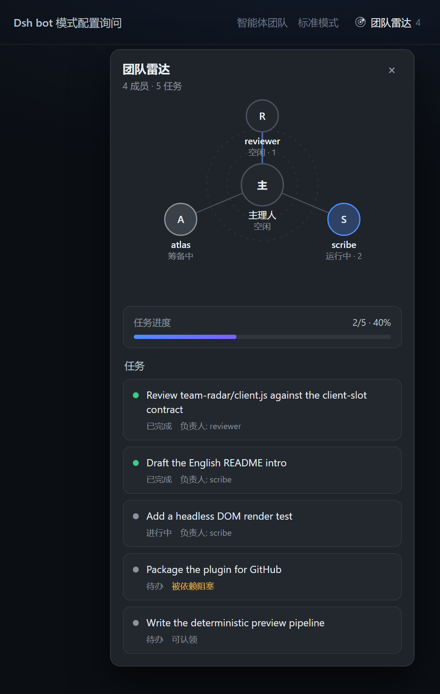

# Team Radar · 团队雷达

[](https://github.com/c64136071-crypto/dsh-team-radar/actions/workflows/test.yml)

把 DeepSeek Harness **Agent Teams** 的成员和共享任务画成一张实时雷达图的 Web UI 插件。

> 这是一个独立插件（bundle），不修改 DSH 本体。安装后会在会话标题栏多出一个「团队雷达」按钮：
> 成员是雷达上的节点，共享任务是下方的进度条和任务卡片，全部从 Session 投影实时更新。



> 截图不是手绘的：它由真实组件在 jsdom 中渲染，再交给无头浏览器截屏
> （`pnpm run preview` + 下方 Edge 命令），与实际运行结果一致。


## 特性

- **雷达图成员视图**：Lead 居中、teammates 环绕；运行中的成员带呼吸光环和旋转扫描线，失败/筹备中/空闲各有独立配色。
- **点节点即开会话**：点击任一成员节点直接跳到它的会话；当前会话成员带虚线外圈；悬停可看模型、认领任务数和失败原因。
- **共享任务看板**：完成任务比例进度条，任务卡片显示负责人、依赖阻塞、可认领状态。
- **实时**：直接读取 Session store 的 `agentTeam` 投影，无需轮询，也不发起额外请求。
- **只读、零副作用**：不创建会话、不发送消息、不写任务。
- **中英双语**：跟随 DSH 界面语言。
- **无构建步骤**：客户端模块就是浏览器模块表可直接加载的 `client.js`。

## 安装

### 方式一：创造模式（推荐）

1. 打开 **插件** 页 → **添加插件** → **让 Agent 创建插件**，进入创造模式会话；
2. 让 Agent 安装本目录的 bundle（`install_bundle`，`target` 指向本目录绝对路径）。

### 方式二：从 GitHub 安装（无需 npm）

```sh
dsh plugin --profile desktop add github:c64136071-crypto/dsh-team-radar
```

### 方式三：本地开发

```sh
dsh plugin --profile desktop add link:/absolute/path/to/team-radar
```

然后把 `dsh-plugin-team-radar` 追加到 profile 的 `package.json` → `dsh.profile.bundles` 列表末尾，刷新页面（DSH 开启 HMR 时自动生效）。

### 方式四：手动（不推荐，仅调试用）

把包链接进 profile 的 `node_modules`，并在 `dsh.profile.bundles` 中选中本包。

### 卸载

```sh
dsh plugin --profile desktop remove dsh-plugin-team-radar
```

并从 `dsh.profile.bundles` 中移除该条目。

## 使用

1. 让 Lead 使用 Agent Teams 创建队友（`spawn_teammate`）和任务（`team_task_create`）；
2. 打开 Lead 会话，点击标题栏的「团队雷达」；
3. 雷达节点会随成员状态实时变化，任务卡片随任务看板更新；点节点可直接跳到成员会话。

没有团队时按钮不显示——它只在 `agentTeam` 投影存在时出现。

## 工作原理

| 文件 | 作用 |
|---|---|
| `cordis.patch.yml` | 插入一个 Host 行，启用本 bundle |
| `index.js` | Host 半边（空 `apply`，能力全在浏览器侧） |
| `client.js` | 浏览器模块：注册 `conversation.session.header.actions` 槽位，渲染雷达面板 |
| `locale/*.json` | 插件页展示用的标题与描述 |
| `scripts/smoke.cjs` | 离线冒烟测试：桩掉 React 与模块加载器，校验注册与组件接线 |

数据来源是 Lead 会话的 `agentTeam` Session 投影（`projectionsBySession[leadSessionId].values.agentTeam`），与 DSH 自带的团队面板同源；成员运行状态来自 `useSessionStatus`，模型信息来自 `modelSelection` 投影。

## 开发

本插件不需要编译：`client.js` 直接使用 DSH 浏览器模块表的 `window.__ModuleLoader__.load({ id, factory })` 约定，`factory(require)` 里的 `require` 只能取平台模块（`react`、`react-dom` 等）。

```sh
pnpm install   # 只装测试用的 devDependencies（react / react-dom / jsdom）
pnpm test      # 冒烟测试 + jsdom 渲染测试
pnpm run preview  # 用真实组件渲染 docs/preview.html（截图素材）
```

- `scripts/smoke.cjs`：桩掉 React 与模块加载器，校验模块注册、槽位注册、中英词典；
- `scripts/render-test.cjs`：jsdom + 真实 React 渲染，点击触发器并断言面板 DOM（雷达节点、任务卡片、进度、当前会话环、节点点击回调）；
- `scripts/screenshot.cjs`：渲染出预览页，配合无头浏览器生成 `docs/screenshot.png`。

实现笔记（插件加载协议、投影、slot、踩坑）见 [docs/blog-dsh-team-radar.md](docs/blog-dsh-team-radar.md)。

修改后：DSH 开启 HMR 时，替换 `client.js` 内容会在下一次组合时热加载；没有 HMR 时重启 DSH。

## 已知限制

- 只读：不支持创建/中断队友、修改任务（这些操作在对话里让 Lead 做）。
- 依赖 Agent Teams 实验包（`@deepseek-ai/dsh-experimental-agent-team-profile`）处于启用状态。
- 仅适配 Web/Desktop 客户端；headless 无 UI。

## License

MIT
